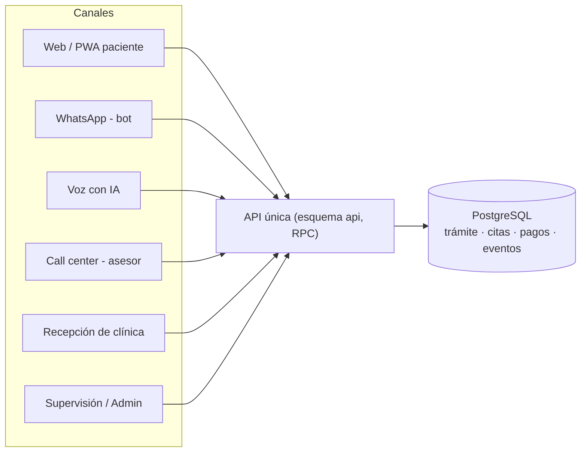

# 1. Resumen ejecutivo

## El problema

Un paciente de Salud Digna puede empezar un trámite en la web, seguirlo por WhatsApp, llamar al call center y
terminar en la clínica. Hoy cada canal es una isla: el paciente repite sus datos, el asesor no sabe qué hizo la
persona en la app, y nadie ve el mismo estado. Eso causa citas duplicadas, pagos que no se reflejan, abandono
de trámites y llamadas largas.

## La solución

Un **orquestador omnicanal**: una sola base de datos con una sola API que guarda **un trámite por paciente** y lo
expone igual a todos los canales. Los canales (web/PWA, WhatsApp, voz con IA, call center, recepción de clínica,
supervisión) dejan de tener lógica propia: **pintan pantallas y llaman a la API**. Las reglas viven en un solo lugar.

## Qué resuelve, en concreto

| Necesidad | Cómo se resuelve |
|---|---|
| "Que no me pidan lo mismo dos veces" | El mismo celular es el mismo paciente en todos los canales (identidad única). |
| "Empecé en la web, sigo por WhatsApp" | El trámite tiene folio y estado; cualquier canal lo retoma donde se quedó. |
| "Que no se agende dos veces lo mismo" | Reglas de duplicados y cupo dentro de la base (no en cada app). |
| "Que nadie me pise mientras me atienden" | Bloqueo por trámite: si un asesor lo tiene, los demás canales lo ven pero no lo cambian. |
| "Privacidad de datos de salud" | Cifrado de mensajes, niveles de verificación, bitácora inmutable, ninguna tabla expuesta. |
| "Que la supervisión vea todo" | Línea de tiempo en vivo, bandeja de atención, métricas permanentes. |

## Qué existe hoy (dato del proyecto)

| Elemento | Cantidad |
|---|---|
| Funciones de la API pública (`api.*`) | 56 |
| Migraciones aplicadas | 37 |
| Pruebas automáticas de base de datos (pgTAP) | 392 en 30 archivos |
| Edge Functions (servidor) | 8 (webhook de WhatsApp, avisos, recordatorios, pagos, OTP, resúmenes, código de Auth, pago de prueba) |
| Clínicas reales cargadas | 261, con horarios y zona horaria |
| Roles | paciente, asesor, recepción, supervisor, admin (+ servicio interno) |
| Canales conectados y probados | web (simulador), WhatsApp (bot con Meta Cloud API), call center y recepción (consola de personal) |

## Qué se midió (medido)

Prueba local con **100 000 pacientes y 2 millones de eventos**, 8 clientes simultáneos sobre `api.iniciar_contacto`
(la operación más pesada de entrada): **9.5 ms promedio, 841 operaciones/segundo, 0 errores**.
Detalle y límites de esa medición en [Escalabilidad](06_escalabilidad.md).

## Por qué Supabase (en una frase)

Porque entrega PostgreSQL completo con autenticación, API, tiempo real, colas, tareas programadas y funciones de
servidor **ya integrados**, lo que permitió construir en días el núcleo que un backend a la medida tardaría
semanas en armar, sin perder la posibilidad de migrar (es PostgreSQL estándar). Ver [comparación](07_por_que_supabase.md).

## Alcance honesto

- Es un **prototipo funcional de hackathon**, no un sistema en producción clínica.
- El **pago es de prueba** (`PAGO_DEMO`): no hay pasarela real conectada.
- WhatsApp usa el **número de prueba de Meta** (solo escribe a números registrados); para el público hay que
  registrar un número propio y aprobar plantillas.
- No hay integración con el sistema clínico/resultados real de Salud Digna.
- Pendiente: PDF de confirmación de pago y cita.

Detalle en [Estado y pendientes](09_estado_y_pendientes.md).
