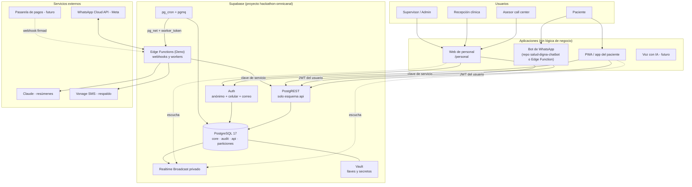
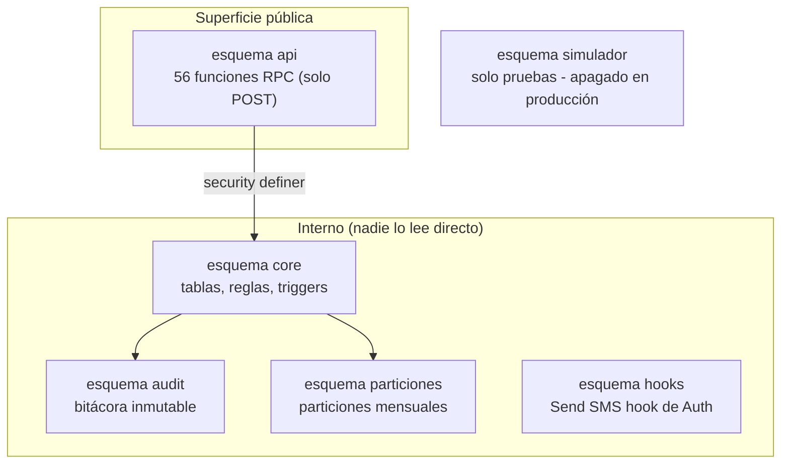
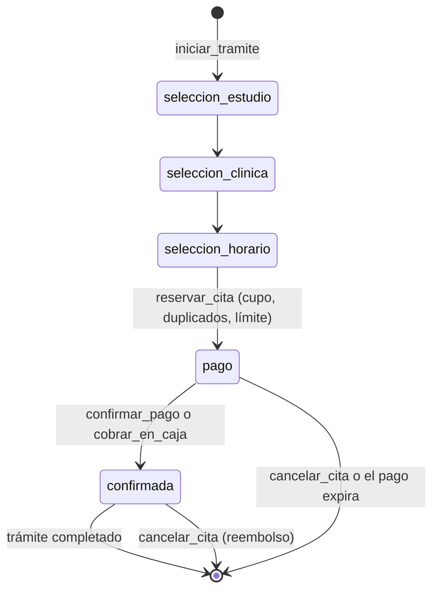
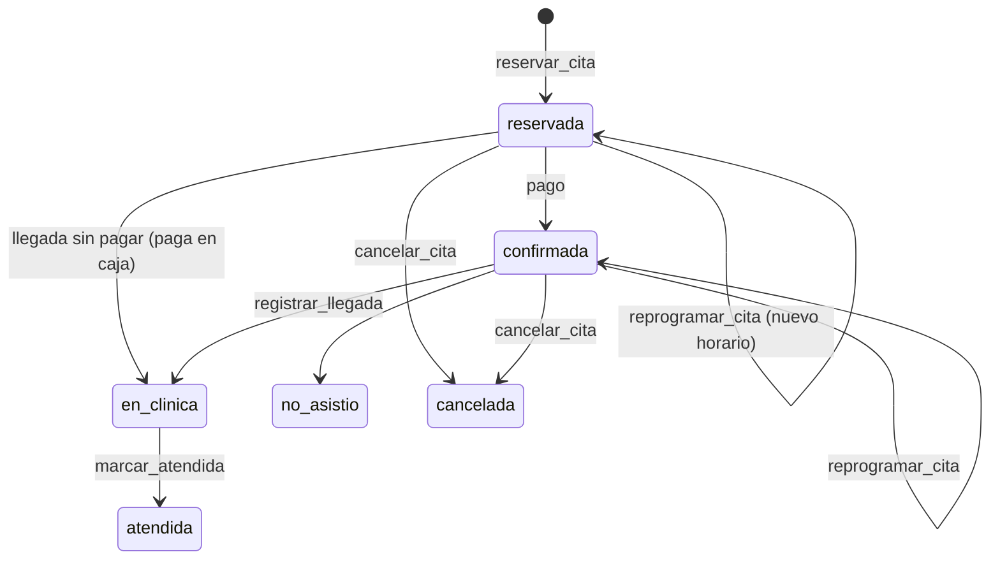
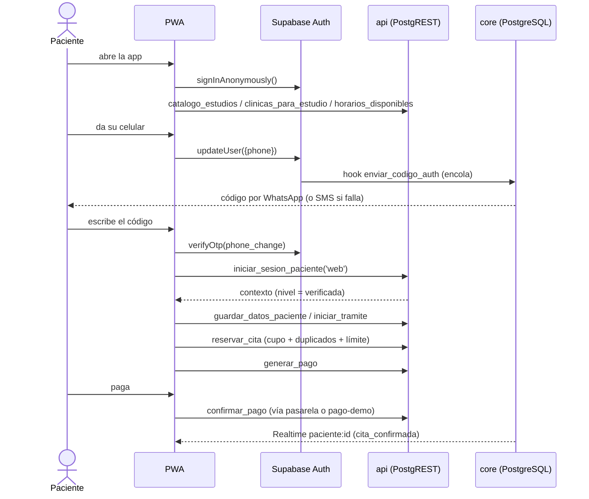
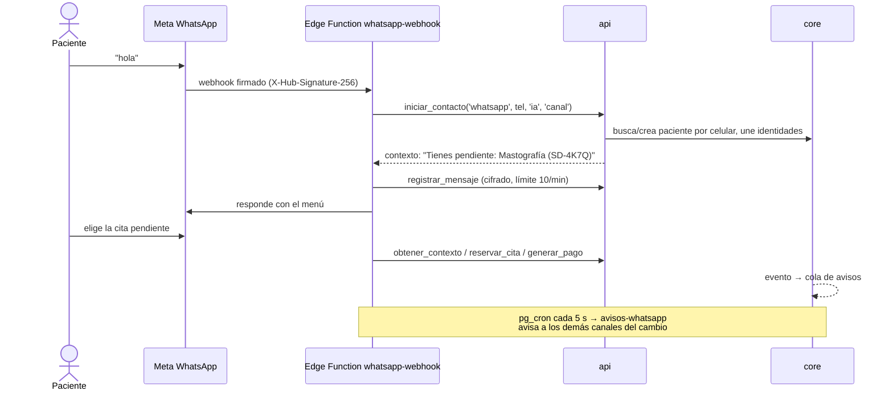
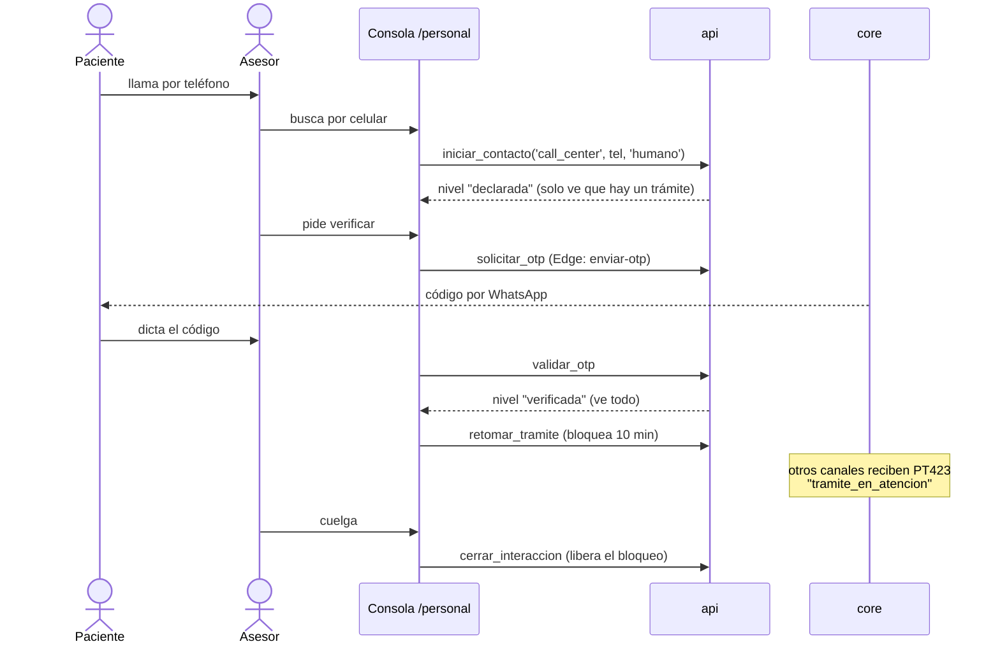
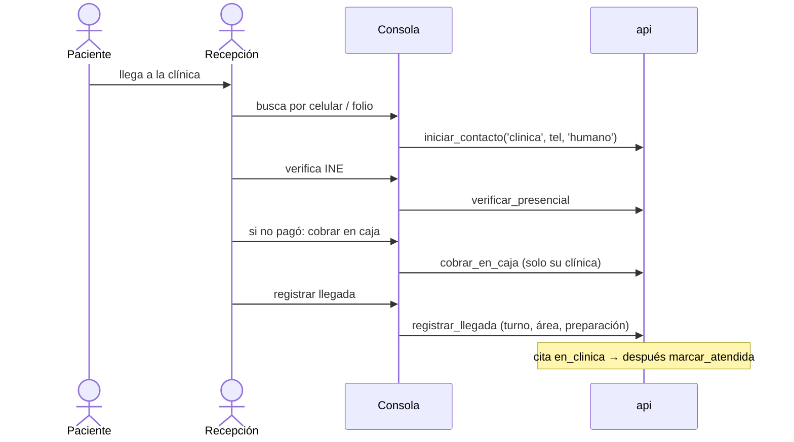
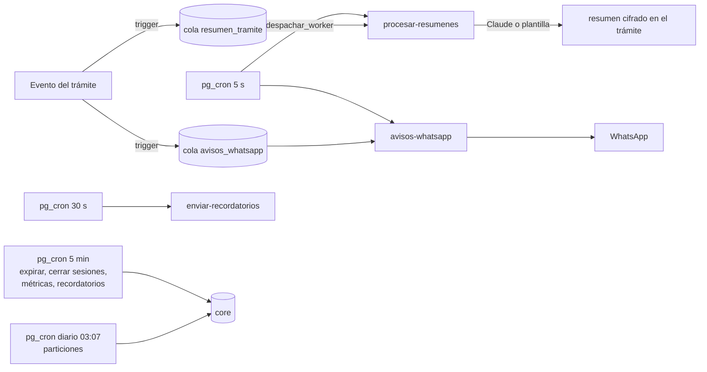

# 2. Arquitectura y diagramas

## 2.1 Vista general (contexto)

**Lectura rápida:** las apps con usuario (web/PWA) hablan con PostgREST con el **JWT del usuario**; todo lo que
necesita la clave de servicio (bot, webhooks, workers) pasa por una **Edge Function** o un servidor propio.
La base empuja eventos a las apps por Realtime y despierta a los workers con `pg_cron` + `pg_net`.

## 2.2 Capas dentro de la base de datos

Principios:

1. **Una sola puerta.** Ni `anon`, ni `authenticated`, ni `service_role` leen tablas. Solo ejecutan funciones `api.*`.
2. **Las funciones validan todo**: rol, nivel de verificación, alcance por clínica, versión, cupo, duplicados.
3. **Todo cambio deja evento** en la línea de tiempo y en la bitácora; es lo que alimenta tiempo real, avisos y métricas.

## 2.3 Ciclo de un trámite

Un trámite de tipo `agendar_estudio` avanza por 5 pasos (tabla `core.flujo_tramite`). El **paso** dice dónde va;
el **estado** del trámite dice si sigue vivo (`activo`, `pausado`, `completado`, `abandonado`, `cancelado`).

La cita tiene su propio ciclo, que es el que ve la clínica:

Estados del **pago**: `pendiente`, `pagado`, `fallido`, `expirado`, `reembolsado`.
Reglas: reprogramar exige al menos 1 hora de anticipación y horario de atención con cupo; cancelar una cita
pagada la marca `reembolsado`, una pendiente `expirado`.

## 2.4 Secuencia: paciente agenda en la web y paga

## 2.5 Secuencia: el mismo trámite continúa en WhatsApp

## 2.6 Secuencia: el asesor toma un trámite

## 2.7 Secuencia: recepción cobra y registra llegada

## 2.8 Procesos en segundo plano

Tareas programadas (`pg_cron`): resúmenes (5 s), avisos de WhatsApp (5 s), recordatorios (30 s), liberar atenciones
vencidas (30 s), programar recordatorios / expirar trámites / cerrar sesiones / recalcular métricas (cada 5 min),
limpieza (cada hora), cancelar trámites sin estudio (cada hora), rotación de cifrado (cada minuto, solo si hay
rotación en curso), particiones (diario).

## 2.9 Despliegue

| Entorno | Qué corre | Para qué |
|---|---|---|
| **Producción de pruebas** (supabase.com, `hackathon-omnicanal`, us-east-1, plan gratis) | Base, Auth, API, Edge Functions, Realtime, cron | Es la base real que usa el equipo y la PWA |
| **Local** (Supabase en Podman) | Lo mismo + esquema `simulador` encendido | Desarrollo, pruebas pgTAP, demo |
| **Simulador** (`simulador/`, Vite + React) | Web de pruebas: paciente, personal, demo | Probar contra local o contra la nube (`npm run dev` / `dev:prod`) |
| **Bot de WhatsApp** | Opción A: Edge Function `whatsapp-webhook` en Supabase (decidida). Opción B: bot Node del compañero | Ver [Conexión omnicanal](04_conexion_omnicanal.md) |
