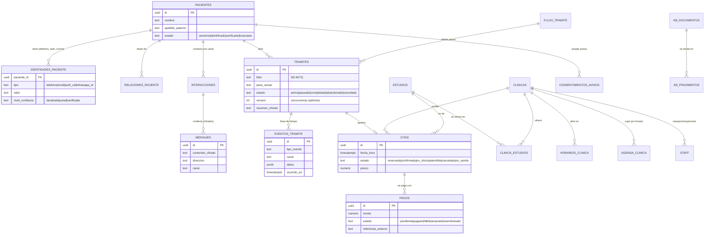
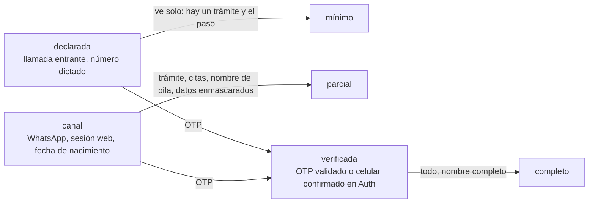

# 3. Modelo de datos

## 3.1 Diagrama entidad-relación (simplificado)

## 3.2 Tablas por función

| Grupo | Tablas | Qué guardan |
|---|---|---|
| **Identidad** | `pacientes`, `identidades_paciente`, `relaciones_paciente`, `paciente_fusiones`, `otp`, `consentimientos_avisos` | Quién es el paciente, con qué credenciales lo conocemos (teléfono, correo, sesión de Auth, id de WhatsApp) y con qué nivel de confianza, familiares (beneficiarios), fusión de duplicados, códigos de un solo uso |
| **Catálogo** | `estudios`, `clinicas`, `clinica_estudios`, `horarios_clinica`, `dias_inhabiles`, `turnos_dia` | 261 clínicas, estudios con precio y área, horarios de atención, festivos |
| **Trámite** | `flujo_tramite`, `tramites`, `interacciones`, `eventos_tramite`, `mensajes` | El trámite con folio, cada contacto por canal, la línea de tiempo y los mensajes cifrados |
| **Citas y pagos** | `citas`, `agenda_clinica`, `pagos` | Citas, cupo por clínica/estudio/hora y pagos |
| **Personal** | `staff` | Quién es asesor/recepción/supervisor/admin y de qué clínica |
| **Conocimiento (RAG)** | `kb_documentos`, `kb_fragmentos` (pgvector, índice HNSW) | Base de conocimiento para respuestas del agente |
| **Operación** | `idempotencia`, `rate_limit`, `codigos_enviados`, `plantillas_whatsapp`, `catalogo_eventos`, `config_cifrado` | Reintentos seguros, límites, plantillas de Meta, catálogo de eventos permitidos, versión de llave |
| **Métricas** | `metricas_tramites_diarias`, `metricas_canales_diarias`, `metricas_citas_diarias`, `estado_metricas` | Agregados permanentes por día |
| **Auditoría** | `audit.registro` | Bitácora inmutable de cambios |

## 3.3 Decisiones de modelado que importan

| Decisión | Por qué |
|---|---|
| **UUIDv7** como clave | Ordenado por tiempo: índices compactos y rápidos al insertar; no revela cuántos pacientes hay |
| **Clave compuesta `(paciente_id, id)`** en tablas por paciente | Todo se consulta por paciente; es la clave natural para particionar o repartir en el futuro |
| **Borrado lógico** (`eliminado_en`) | Los datos de pacientes no se borran; los triggers bloquean `DELETE` |
| **Concurrencia optimista** (`version`) | Dos canales editando el mismo trámite: el segundo recibe `PT409` y recarga, sin pisarse |
| **Eventos como fuente de verdad** | Línea de tiempo, avisos, resumen, métricas y journey salen del mismo flujo de eventos |
| **Identidad por niveles**, no por "logueado o no" | Un celular dictado no es lo mismo que un celular probado con código |
| **Particiones mensuales** en `eventos_tramite`, `mensajes` y `audit.registro` | Las tablas que más crecen se reparten por mes (esquema `particiones`, creadas solas cada noche) |
| **Métricas en tablas permanentes** recalculadas por día afectado | El tablero no recorre millones de eventos |
| **Cifrado de columnas** en mensajes y resúmenes | El dato más sensible nunca se lee con un `select` |

## 3.4 Niveles de verificación (corazón de la privacidad)

La fecha de nacimiento **nunca** da `verificada`: es un dato que la familia conoce.
Un contexto devuelto por `core.contexto_json` se recorta automáticamente según este nivel; el cliente no decide qué ver.

## 3.5 Eventos (lo que lee todo el sistema)

Los eventos se definen en `core.catalogo_eventos`, agrupados en categorías: `identidad`, `tramite`, `interaccion`,
`cita`, `pago`, `seguridad`, `sistema`. Ejemplos: `tramite_iniciado`, `cita_reservada`, `pago_generado`,
`pago_confirmado` (con `metodo` y `en_caja`), `cita_confirmada`, `cita_reprogramada`, `cita_cancelada`,
`cita_atendida`, `llegada_registrada`, `verificacion_bloqueada`, `limite_citas_alcanzado`.
Un evento fuera del catálogo se rechaza.
