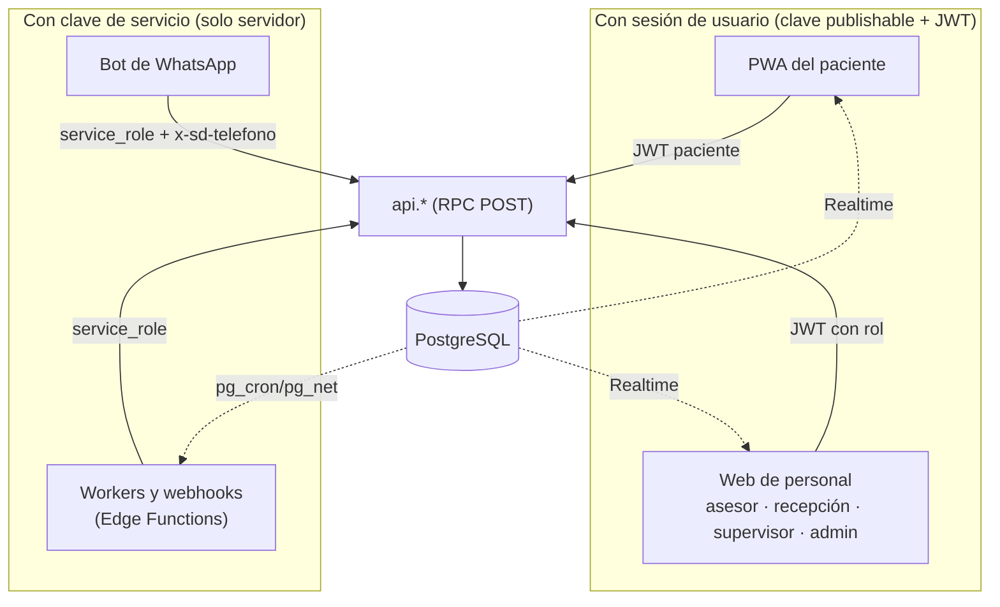
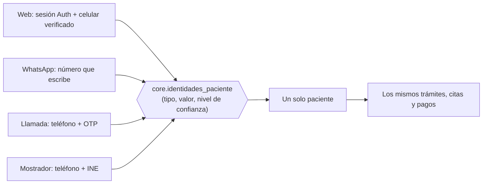
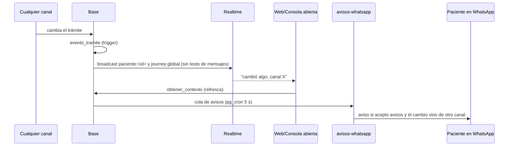

# 4. Cómo deben conectarse las aplicaciones (omnicanal)

## 4.1 La idea en una frase

**Todas las aplicaciones hablan con la misma API de la misma base. Ninguna guarda estado del negocio por su cuenta.**
El "omnicanal" no es una integración entre apps: es que todas leen y escriben el **mismo trámite** del **mismo paciente**.

## 4.2 Las cuatro reglas del contrato

1. **Una sola puerta:** solo se llama a `api.*` por RPC con **POST**. Nada de leer tablas.
2. **La clave secreta nunca sale del servidor.** Navegadores y apps usan la clave *publishable*. Lo que necesita
   `service_role` (bot, webhooks) corre en una Edge Function o en un servidor propio.
3. **Se decide por el código de error**, no por el texto (`42501`, `PT404`, `22023`, `P0001`, `PT409`, `PT423`, `PT429`, `PT405`).
4. **Se manda la versión del trámite** y se recarga ante `PT409`. Así dos canales no se pisan.

## 4.3 Qué credencial usa cada canal

| Canal | Quién es en la base | Credencial | Cómo identifica al paciente | Nivel inicial |
|---|---|---|---|---|
| Web / PWA | Rol `paciente` (usuario de Auth anónimo o con celular) | JWT del usuario | Sesión de Auth + OTP del celular | `canal` → `verificada` tras el OTP |
| WhatsApp | `service_role` actuando por el paciente | Clave de servicio + header `x-sd-telefono` | El número que escribe (Meta lo prueba) | `canal` |
| Voz con IA | `service_role` | Clave de servicio | Número de la llamada | `declarada` |
| Call center | Rol `asesor` | Correo y contraseña → JWT | Teléfono buscado + OTP que el paciente dicta | `declarada` → `verificada` |
| Recepción | Rol `recepcion` con `clinica_id` | Correo y contraseña → JWT | Teléfono + INE en mostrador (`verificar_presencial`) | `verificada` |
| Supervisión / Admin | Rol `supervisor` / `admin` | Correo y contraseña → JWT | No actúa por un paciente: consulta | — |

## 4.4 Por qué el mismo paciente aparece igual en todos los canales

- Las identidades se **vinculan** al mismo paciente por el celular.
- Si aparecen dos pacientes que resultan ser la misma persona, se **fusionan** (`paciente_fusiones`); un dato solo
  *declarado* nunca fusiona.
- El OTP siempre se manda al **teléfono de mayor confianza** ya registrado, no al número que dicta quien llama.

## 4.5 Qué ve y hace cada canal del mismo trámite

| Acción | Web/PWA | WhatsApp | Asesor | Recepción | Supervisión |
|---|---|---|---|---|---|
| Ver catálogo, clínicas, horarios | ✔ | ✔ | ✔ | ✔ | — |
| Registrar datos del titular | ✔ | ✔ (pregunta nombre) | ✔ (tras OTP) | ✔ | — |
| Iniciar trámite / agendar | ✔ | ✔ | ✔ | ✔ (también hoy) | — |
| Cambiar horario | ✔ | ✔ (solo bot Node, ver 4.8) | ✔ | ✔ | — |
| Pagar | ✔ (link / pago-demo) | ✔ ("PAGAR") | genera link | cobra en caja | — |
| Cancelar | ✔ | ✔ (solo bot Node, ver 4.8) | ✔ | ✔ | — |
| Registrar llegada / atendida | — | — | — | ✔ | — |
| Ver línea de tiempo en vivo | ✔ (suya) | — | ✔ (de quien atiende) | ✔ (de quien atiende) | ✔ (global) |
| Bandeja, journey, métricas | — | — | — | — | ✔ |

## 4.6 Coordinación entre canales

| Mecanismo | Qué evita | Cómo funciona |
|---|---|---|
| **Bloqueo por atención** | Que dos personas editen a la vez | El asesor o recepción que abre un trámite lo bloquea 10 min (se renuevan con cada acción). Los demás reciben `PT423 tramite_en_atencion` y WhatsApp avisa con plantilla |
| **Versión del trámite** | Pisar cambios de otro canal | `PT409` si la versión ya cambió |
| **Duplicados** | Dos trámites o citas iguales | Mismo estudio + misma persona con trámite abierto o cita futura → `PT409` con el folio existente |
| **Cupo por horario** | Sobrecupo | `agenda_clinica` cuenta la ocupación; `PT409` si se llenó |
| **Límite de citas futuras** | Spam | Máximo 5; responde `limite_citas` y guarda evento |
| **Idempotencia** | Reintentos duplicados | Llave de idempotencia en operaciones críticas |
| **Alcance por clínica** | Que recepción opere otra clínica | `validar_alcance_clinica` |

## 4.7 Tiempo real y avisos

- Los avisos por WhatsApp salen **solo** a teléfonos verificados que aceptaron avisos.
- Dentro de la ventana de 24 h de Meta: texto libre. Fuera de ella: **plantillas aprobadas** (`link_pago`,
  `cita_confirmada`, `recordatorio_tramite_pendiente`, `asesor_atendiendo`, `recepcion_atendiendo`).
- El broadcast no lleva el texto de los mensajes (están cifrados): quien escucha vuelve a pedir el contexto.

## 4.8 Dos formas de conectar el bot de WhatsApp

| | **A. Edge Function en Supabase** (decidida) | **B. Bot Node del compañero** |
|---|---|---|
| Dónde corre | `supabase/functions/whatsapp-webhook` | `salud-digna-chatbot/bot` (puerto 3001) |
| Quién habla con Meta | Meta → la función directamente | Meta → el servidor del bot (requiere URL pública) |
| Clave de servicio | Secreto de la función | Variable `SUPABASE_SERVICE_ROLE_KEY` del servidor |
| Hospedaje | Ninguno extra | Hay que hospedarlo |
| Ventaja | Cero infraestructura, mismo despliegue. Hoy agenda y paga, pero **no** cancela ni reprograma | Conversación más rica; ya tiene fase 2 (cancelar, reprogramar cita) |
| Cómo se conecta | — | `bot/src/omnicanal.js` llama `POST /rest/v1/rpc/<función>` con `Content-Profile: api` y `x-sd-telefono` |

Ambos usan la **misma API**, así que son intercambiables sin tocar la base. Si algún día se desea combinar,
la fase 3 sería: Meta → nuestro webhook → reenviar al bot (la base sigue siendo la fuente de verdad).

## 4.9 Receta para conectar una aplicación nueva

1. Decidir si es **cliente** (usuario con sesión) o **servidor** (actúa por pacientes).
2. Cliente: `createClient(URL, publishable, { db: { schema: 'api' } })`, autenticar y llamar `rpc(...)`.
   Servidor: llamar `POST {URL}/rest/v1/rpc/{funcion}` con `Content-Profile: api` y `x-sd-telefono`.
3. Entrar con `iniciar_sesion_paciente` (web) o `iniciar_contacto` (el resto) y trabajar con el **contexto** que devuelve.
4. Pintar solo lo que viene en el contexto; **no reimplementar reglas**.
5. Escuchar `paciente:<id>` para refrescar; no hacer polling.
6. Manejar los 8 códigos de error.
7. Si falta algo en la API: **pedirlo** (nueva migración + prueba), no resolverlo en la app.

La guía operativa completa está en [`../GUIA_APP_PWA.md`](../GUIA_APP_PWA.md).
