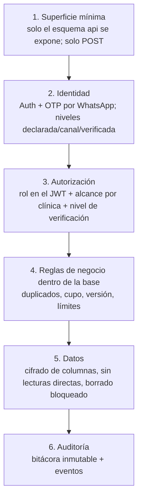

# 5. Seguridad y privacidad

Los datos de salud y los celulares de pacientes son sensibles. El diseño parte de "nadie confía en nadie":
la seguridad vive **en la base**, no en cada aplicación.

## 5.1 Capas de defensa

## 5.2 Controles concretos

| Riesgo | Control | Dónde |
|---|---|---|
| Leer tablas directo | Ningún rol (`anon`, `authenticated`, `service_role`) tiene permiso sobre `core`/`audit`; solo ejecutan `api.*` | Prueba `001_acceso_directo` |
| Funciones `security definer` abusadas | `search_path` vacío, revocar a `public`/`anon` | Cada función |
| Usar GET para saltarse límites | La API solo acepta POST (`PT405`) | `20261124165913_solo_post` |
| Robo de historial de otro paciente | `Confirm phone` obligatorio en Auth; vinculación solo con `phone_confirmed_at` | README, paso 5 |
| Fuerza bruta de OTP y fechas | 3 OTP por paciente/10 min; 3 fechas erróneas/15 min; bloqueo temporal | `verificacion`, `otp` |
| Abuso de la API | Límite por minuto: anon 30 (IP), paciente 120, personal 600, servicio 300 por teléfono | `core.verificar_peticion()` |
| Spam por WhatsApp | 10 mensajes entrantes por minuto por teléfono (`PT429`) | `registrar_mensaje` |
| Citas masivas | Máximo 5 citas futuras | `reservar_cita` |
| Mensajes legibles en la base | AES-256 (`pgp_sym_encrypt`) con llave en **Vault**, versionada y rotable | `cifrado_columnas` |
| Llave comprometida | Rotación por lotes sin parar el servicio (`core.rotar_clave`) | Cron cada minuto mientras rota |
| Borrar evidencia | Triggers bloquean `DELETE`; solo permitido en demo (`app.operacion='reinicio_demo'` con `simulador.config.habilitado`) | `trg_bloquear_delete` |
| Bitácora adulterada | `audit.registro` inmutable; las columnas cifradas se guardan como `[cifrado]` | `audit` |
| Webhooks falsos | Firma `X-Hub-Signature-256` (WhatsApp) y HMAC `x-firma` (pagos); sin secreto responden 401 | Edge Functions |
| Invocar workers desde fuera | Solo la base los llama con `worker_token` (Vault) | `esLlamadaInterna` |
| Personal de otra clínica | `validar_alcance_clinica`: recepción solo opera su `clinica_id` (viene en el JWT) | Pruebas `160`, `260` |
| Dos personas en el mismo trámite | Bloqueo por atención (`PT423`) | `omnicanal_tramites` |
| Simulador en producción | Apagado (`habilitado=false`); sus funciones responden `42501`; se puede borrar el esquema | README |
| Sesión del personal olvidada | Cierre a los 30 min de inactividad | `/personal` |

## 5.3 Manejo de secretos

| Secreto | Dónde vive | ¿Lo ve una app? |
|---|---|---|
| Clave **publishable** | En la app | Sí (es pública por diseño) |
| Clave **secreta** (`service_role`) | Variables de las Edge Functions o del servidor del bot | **Nunca** en un navegador |
| `worker_token`, `WHATSAPP_TOKEN`, `WHATSAPP_APP_SECRET`, `PAGOS_WEBHOOK_SECRET` | Secretos de funciones + Vault | No |
| Llaves de cifrado `clave_cifrado_vN` | Vault (se generan dentro de la base) | No |
| Contraseña de la base | Solo quien administra el proyecto | No |
| Contraseña del personal de pruebas | `docs/CREDENCIALES_EQUIPO.md` (ignorado por git) | Solo el equipo |

## 5.4 Privacidad por diseño

- **Mínimo necesario por nivel:** quien solo conoce un teléfono no ve nada clínico.
- **Datos enmascarados** (`Paciente +52******4567`) en listas del personal para pacientes sin nombre.
- **Consentimiento explícito** para avisos proactivos por WhatsApp; sin él, no se envía nada.
- **Retención:** no se borra ni archiva nada con datos de pacientes (decisión consciente, ver [decisiones](08_decisiones.md)).
  Solo se limpian contadores técnicos.

## 5.5 Riesgos conocidos y fuera de alcance

- Cumplimiento formal (LFPDPPP, NOM-024 de expediente clínico, aviso de privacidad) **no está evaluado**.
- No hay pruebas de penetración externas; la verificación es la suite pgTAP (403 pruebas) y revisión propia.
- Plan gratis de Supabase: sin respaldos con recuperación a un punto en el tiempo (PITR) y sin SLA.
- El teléfono de pruebas de Meta solo envía a números registrados.
