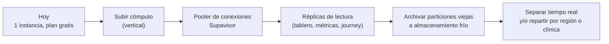

# 6. Escalabilidad

> Esta página separa tres cosas para no inflar nada: **medido** (hay una prueba en el repositorio),
> **dato del proyecto** (sale del código) y **estimación** (cálculo con supuestos escritos). No tenemos cifras
> reales de Salud Digna; los escenarios son ilustrativos y se pueden reemplazar con sus números.

## 6.1 Lo que se midió

| Prueba | Condiciones | Resultado |
|---|---|---|
| `tests/20_carga_volumen.sql` + `tests/21_pgbench_contacto.sql` | Laptop i7-10750H, Supabase local en Podman, **100 000 pacientes y 2 M de eventos**, 8 clientes, 20 s, operación `api.iniciar_contacto` | **9.5 ms promedio, 841 ops/s, 0 errores** |
| Pruebas de concurrencia (`080`) | Versión, idempotencia, cupo por horario | Un solo ganador por cupo; el resto recibe `PT409` |

Lo que **no** se midió todavía: mezcla realista de operaciones (agendar + pagar + leer contexto + realtime),
Realtime con miles de conexiones, ni el plan gratis de Supabase (su cómputo es mucho menor que el de la laptop).

## 6.2 Por qué la arquitectura escala (mecanismos presentes hoy)

| Mecanismo | Qué problema previene | Estado |
|---|---|---|
| Lógica **en la base** (funciones `security definer`) | Muchos viajes red app↔base por operación; cada acción es una sola llamada | Hecho |
| **Particiones mensuales** en `eventos_tramite`, `mensajes`, `audit.registro` | Tablas de cientos de millones de filas lentas de consultar y de mantener | Hecho (se crean solas, `sd-particiones`) |
| **Clave `(paciente_id, id)`** | Todo acceso es por paciente → localidad de datos; base natural para repartir después | Hecho |
| **UUIDv7** | Inserciones dispersas que rompen índices | Hecho |
| **Índices parciales** (`where estado in ('activo','pausado')`) | Escanear trámites cerrados, que son la mayoría | Hecho |
| **Métricas pre-agregadas** recalculadas por día afectado | Que el tablero recorra millones de eventos | Hecho |
| **Colas (`pgmq`)** + workers | Que una llamada lenta (IA, WhatsApp) bloquee al paciente | Hecho |
| **Edge Functions sin estado** | Cuello de botella en un servidor de aplicación | Escalan solas horizontalmente |
| **Rate limit** en `UNLOGGED` | Costo de escritura del propio limitador | Hecho |
| **Cupo por fila** (`agenda_clinica` por clínica+estudio+hora) | Bloqueos globales: dos clínicas distintas nunca compiten | Hecho |
| **Índice HNSW** (pgvector) | Búsqueda semántica lenta al crecer la base de conocimiento | Hecho |
| **Concurrencia optimista** (`version`) | Bloqueos largos entre canales | Hecho |

## 6.3 Escenarios (estimación)

Supuestos, todos editables:

- Trámite iniciado ≈ 2 por cita agendada (la mitad se abandona o cancela).
- ≈ 15 eventos por trámite y ≈ 20 mensajes por trámite que pasa por WhatsApp (50 % de los trámites).
- Fila de evento ≈ 400 B y de mensaje cifrado ≈ 600 B, **con índices ×1.5**.
- Jornada de 10 h; horas pico = 3× el promedio; ≈ 30 llamadas a la API por trámite (lecturas de contexto incluidas).

| | **Piloto** | **Regional** | **Nacional** |
|---|---|---|---|
| Clínicas | 5 | 30 | 261 (las que están cargadas) |
| Citas por clínica al día (supuesto) | 50 | 80 | 100 |
| Citas al día | 250 | 2 400 | 26 100 |
| Trámites al día | 500 | 4 800 | 52 200 |
| Eventos + mensajes al día | ≈ 12 500 | ≈ 120 000 | ≈ 1.3 M |
| Almacenamiento al día | ≈ 10 MB | ≈ 90 MB | ≈ 0.9 GB |
| Almacenamiento al año | ≈ 3.5 GB | ≈ 30 GB | ≈ 340 GB |
| Llamadas a la API, promedio | ≈ 0.4/s | ≈ 4/s | ≈ 45/s |
| Llamadas a la API, pico (×3) | ≈ 1.2/s | ≈ 12/s | ≈ 135/s |
| Filas nuevas por segundo, pico (eventos + mensajes) | ≈ 1/s | ≈ 10/s | ≈ 110/s |

Lectura:

- Hasta **regional**, un solo PostgreSQL de tamaño modesto sobra con un margen enorme.
- En **nacional**, el pico estimado (~135 llamadas/s) está **por debajo** de lo medido en una laptop (841 ops/s en
  la operación probada), pero ese número es de una sola operación y no cubre toda la mezcla. Conclusión prudente:
  **alcanza con una instancia de tamaño medio, con holgura de ~5×**, y hay que medir la mezcla real antes de comprometerse.
- Lo que más pesa en nacional **no es la velocidad, es el volumen guardado** (~340 GB/año con todo en línea).
  Eso exige una política de retención/archivo (ver 6.5), que hoy **no existe**.

## 6.4 Ruta de crecimiento (en orden de costo y esfuerzo)

| Paso | Cuándo | Costo de cambio |
|---|---|---|
| 1. Subir el tamaño de la instancia | Primeros signos de CPU/IO | Nulo en código |
| 2. Pooler de conexiones | Muchas Edge Functions y clientes abren conexiones | Cambiar la cadena de conexión |
| 3. Réplicas de lectura | Supervisión y métricas compiten con la operación | Dirigir las lecturas pesadas a la réplica (`metricas`, `bandeja_atencion`, `journey`) |
| 4. Archivar particiones antiguas | El volumen supera lo cómodo en disco | Un job que mueva/desacople particiones; ya están separadas por mes |
| 5. Repartir (sharding) | Si un solo servidor deja de bastar | La clave `(paciente_id, …)` y el cupo por clínica hacen que el reparto por paciente o por región sea natural |

## 6.5 Cuellos de botella probables y su mitigación

| Posible cuello | Por qué | Mitigación |
|---|---|---|
| `core.contexto_json` | Se recalcula en cada lectura e incluye trámites, citas, pagos y línea de tiempo | Limitar tamaño (ya acota `p_datos`), índice por paciente; si hiciera falta, materializar |
| Cola de avisos/resúmenes cada 5 s | Sondeo con `pg_cron` | Lotes (`cola_leer` con cantidad), subir el intervalo o pasar a eventos |
| **Realtime** con muchas conexiones | Límite de conexiones y mensajes por plan | Suscribir solo a `paciente:<id>` (ya es así); `journey:global` solo para supervisión |
| Volumen sin retención | Sin archivado, solo crece | Definir retención por normativa y archivar particiones |
| Cupo de un horario muy pedido | Muchos intentos sobre la misma fila | Es una sola fila por clínica+estudio+hora; el bloqueo es corto; los perdedores reciben `PT409` |
| WhatsApp (Meta) | Límites de mensajes y ventana de 24 h, plantillas | Plantillas aprobadas, cola con reintentos y corte limpio cuando no se entrega |
| Región | El proyecto está en us-east-1; los usuarios están en México | Al pasar a producción, elegir la región más cercana |
| Plan gratis | Se pausa tras una semana sin uso; cómputo compartido | Plan de pago para operar de verdad |

## 6.6 Escalabilidad de *equipo* (no solo de servidores)

- **Cada canal nuevo se agrega sin tocar la base:** basta con que llame a `api.*`. Voz con IA, una app nativa
  o un kiosco usan el mismo contrato.
- **Las reglas viven una vez:** cambiar el límite de citas o el horario de una clínica se hace en un solo lugar.
- **403 pruebas automáticas** permiten cambiar con confianza; cada cambio de base va en una migración nueva con su prueba.
